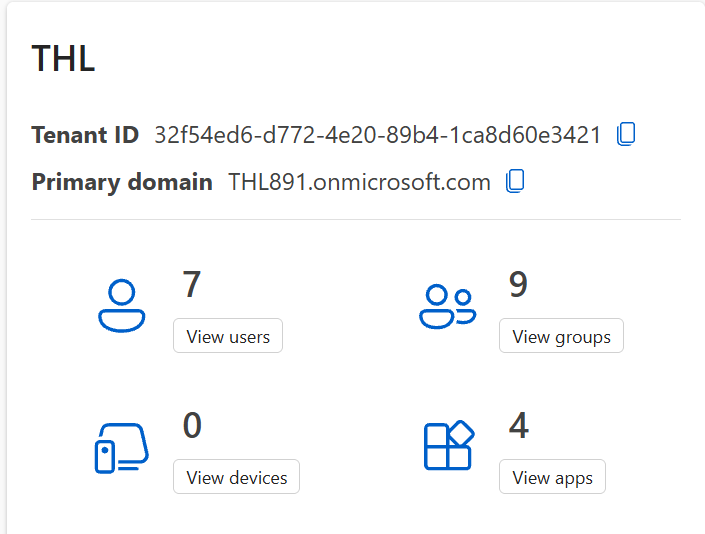
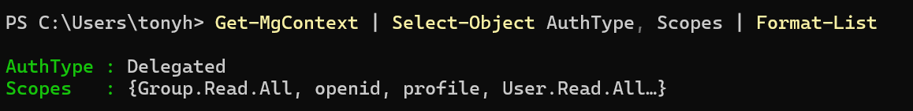
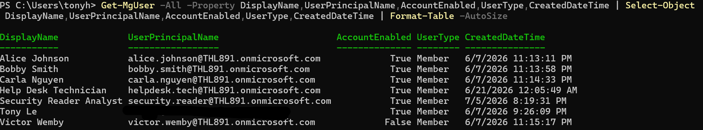
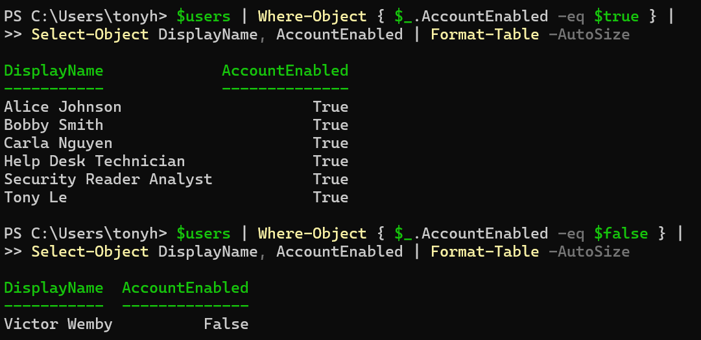

# Microsoft Entra ID Identity Audit Using Microsoft Graph PowerShell

## Project Overview

This project demonstrates a hands-on Identity and Access Management (IAM) security audit using Microsoft Entra ID and Microsoft Graph PowerShell.

The objective is to inventory cloud identities, analyze account configurations, inspect access assignments, and identify potential identity security risks within a simulated enterprise environment.

The lab uses an existing Microsoft Entra ID tenant representing a fictional financial services organization, THL.

## Technologies Used

- Microsoft Entra ID
- Microsoft Graph PowerShell SDK v2.41.2
- PowerShell 7.6.9
- Microsoft Graph API
- OAuth 2.0 delegated authentication

## Lab Environment

| Component | Configuration |
|---|---|
| Identity provider | Microsoft Entra ID |
| Environment | Existing laboratory tenant |
| Users | 7 |
| Groups | 9 |
| Applications shown in tenant overview | 4 |
| Devices | 0 |
| Administrator access | Global Administrator |
| Authentication method | Delegated Microsoft Graph authentication |

## Project Objectives

1. Establish a secure connection to Microsoft Graph.
2. Retrieve and inventory Entra ID user accounts.
3. Analyze enabled and disabled accounts.
4. Examine group memberships and access assignments.
5. Identify potentially excessive or unnecessary access.
6. Export audit results and develop security recommendations.

## Work Completed

### 1. Environment Verification

Verified access to the existing Entra ID tenant and identified seven users, nine groups, and four applications displayed in the tenant overview.

### 2. Microsoft Graph Configuration

Verified PowerShell 7.6.9 and installed Microsoft Graph Authentication, Users, and Groups modules, version 2.41.2.

Established a delegated Microsoft Graph connection requesting `User.Read.All` and `Group.Read.All` permissions.

### 3. User Inventory

Retrieved seven user accounts and collected identity attributes, including display name, user principal name, account status, user type, and account creation date.

### 4. Account Status Analysis

Used PowerShell filtering to identify six enabled accounts and one disabled account.

The disabled account was flagged for further investigation into retained access assignments.

## Preliminary Results

| Metric | Result |
|---|---:|
| Total user accounts | 7 |
| Enabled accounts | 6 |
| Disabled accounts | 1 |
| Member accounts | 7 |
| Guest accounts | 0 |

These results are preliminary inventory observations, not confirmed security vulnerabilities.

## Audit Evidence

### 1. Entra ID Environment Overview

The assessment environment contains 7 user accounts, 9 groups, and 4 enterprise applications.

  

### 2. Microsoft Graph Authentication

Verified delegated Microsoft Graph authentication and the permissions available for read-only identity enumeration.

  

### 3. User Account Inventory

Enumerated Entra ID user accounts using Microsoft Graph PowerShell, collecting account status, user type, and creation timestamps.

  

### 4. Account Status Review

Identified 6 enabled accounts and 1 disabled account to establish a baseline for subsequent identity security assessments.

## Project Status

**In progress:** Account status analysis completed. Group membership and access assignment investigations are next.
